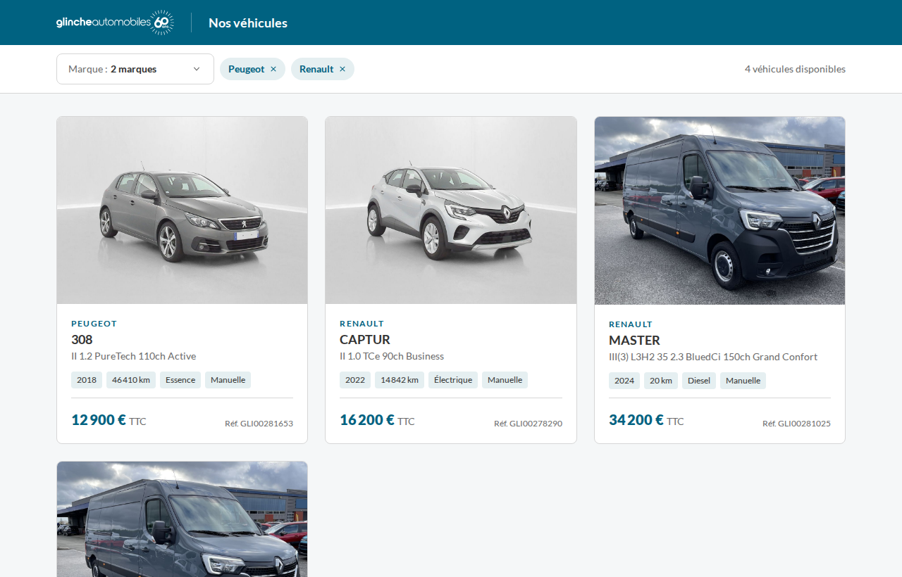
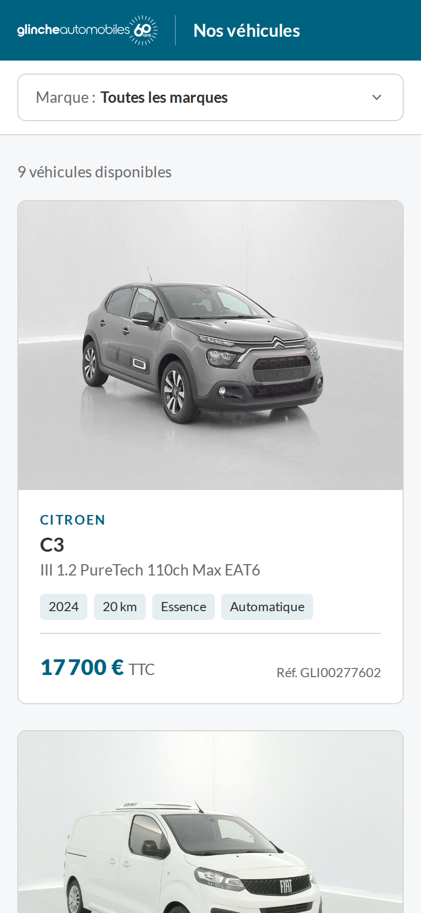
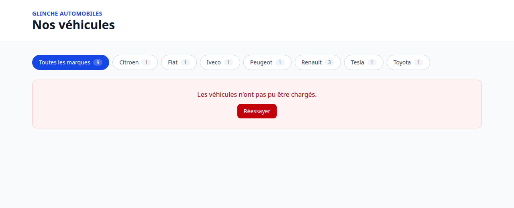
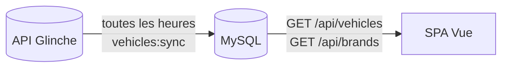
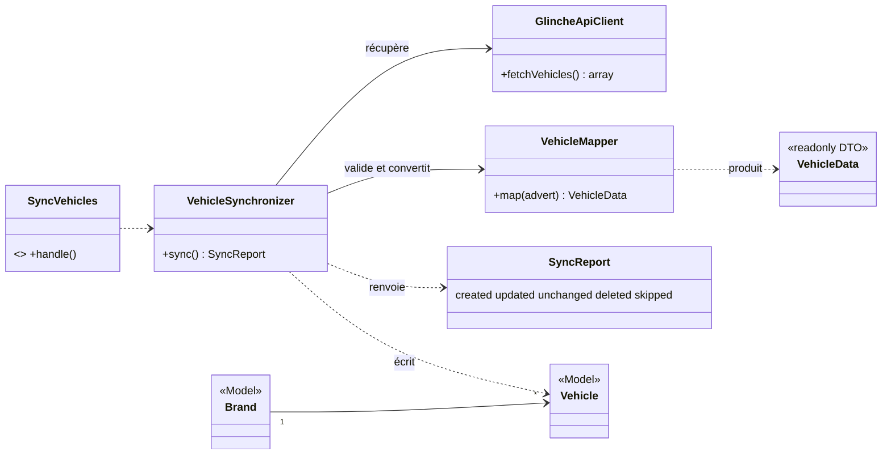

# Glinche, catalogue de véhicules

Récupère le stock de l'API partenaires Glinche, le stocke en base et l'affiche avec un filtre multi-marques et une pagination.

**Laravel 13 · MySQL 9.7 · Vue 3.5 · TypeScript · Tailwind CSS 4 · Docker** · 94 tests



<table><tr>
  <td width="28%"></td>
  <td valign="top"></td>
</tr></table>

*Filtre sur deux marques · version mobile · API indisponible.*

## Lancer

```bash
cp backend/.env.example backend/.env   # renseigner les 3 variables GLINCHE_*
docker compose up -d --build           # migrations et première synchro incluses (~1 min)
```

Catalogue : http://localhost:5173 · API : http://localhost:8000/api

```bash
docker compose exec app php artisan vehicles:sync   # synchro manuelle (sinon toutes les heures)
docker compose exec app php artisan test            # 61 tests Pest
docker compose exec node npm test                   # 33 tests Vitest
docker compose exec node npm run typecheck          # vérification TypeScript (vue-tsc)
```

<details>
<summary>Sans Docker</summary>

```bash
cd backend && composer install && cp .env.example .env && php artisan key:generate
# .env : GLINCHE_*, et DB_CONNECTION=sqlite à la place du bloc DB_* pour aller vite
touch database/database.sqlite && php artisan migrate && php artisan vehicles:sync && php artisan serve
cd frontend && npm install && npm run dev
```

</details>

## Fonctionnement



Le catalogue lit **uniquement la base locale** : il reste rapide et disponible même quand Glinche ne répond pas. Seule la synchronisation parle à Glinche.

## Ce qui est garanti

| Situation | Résultat |
|---|---|
| L'API Glinche est en panne | La base n'est pas touchée (appel fait avant la transaction) |
| Une annonce est malformée | Elle est ignorée et journalisée, les autres sont synchronisées |
| Un véhicule disparaît du flux ou a une `deleteDate` | Il est supprimé du catalogue |
| On relance la synchro sans changement | `0 created, 0 updated, 9 unchanged` |
| Deux synchros en même temps | La seconde s'arrête (verrou) |
| Le token expire (`401`) | Reconnexion automatique, une fois |
| Erreur serveur Glinche (5xx) | 3 tentatives, puis échec propre |
| « Citroën » et « Citroen » | Une seule marque (identifiée par slug) |
| Prix absent ou à 0 | « Prix sur demande », jamais « 0 € » |
| Lien `?brand=peugeot,renault&page=2` partagé | Même sélection, bouton retour fonctionnel |
| Clics rapides sur les filtres | Seule la dernière réponse s'affiche (requête précédente annulée) |
| L'API du catalogue ne répond pas | Abandon après 10 s et bouton « Réessayer » |

Chaque ligne est couverte par un test.

## Code



Une classe, une responsabilité : le **client** gère HTTP et le token, le **mapper** le format Glinche, le **synchroniseur** les règles de mise à jour. Tout est dans `backend/app/Services/Glinche/`.

Côté front : `App.vue`, 5 composants, 3 composables (`useBrands`, `useVehicles`, `useUrlQuery`). Les réponses de l'API sont typées dans `types.ts` et l'URL est la seule source d'état. L'en-tête et la barre de filtres restent fixés en haut ; le filtre est un menu à cases à cocher (clavier, Échap, clic extérieur) et la pagination est numérotée, avec des points de suspension (`utils/pagination.ts`). Pendant le chargement, des squelettes reprennent la forme des cartes et du filtre.

## Choix techniques

- **Prix en centimes** (entier), converti depuis la chaîne : aucune erreur d'arrondi.
- **Pagination côté serveur**, 6 par page (grille de 1, 2 ou 3 colonnes), tri stable marque → modèle → id.
- **Annonce brute conservée** (colonne `raw`) : une fiche détaillée pourra s'en servir sans nouvel appel.
- **Pas de Pinia, Vue Router ni repository pattern** : un seul écran, rien à justifier.
- **TypeScript strict** : `vue-tsc` vérifie aussi les templates, avant chaque build.
- **Filtre multi-marques** : un seul paramètre `brand` avec des slugs séparés par des virgules, lisible dans l'URL et compatible avec les liens à une marque.
- **Charte Glinche** : bleu pétrole `#006281`, police Lato et logo officiel, relevés sur glinche-automobiles.com. Les couleurs sont des tokens Tailwind dans `style.css`, sans ombres portées.
- **Même origine** : Vite relaie `/api` vers nginx, donc aucune configuration CORS.

## Points notables

- `GET /partners/vehicles` renvoie **tout le stock d'un coup**, sans pagination : vérifié dans la spécification OpenAPI et par appel réel.
- **MySQL réordonne les clés JSON** : la synchro voyait chaque véhicule comme modifié. Invisible sur SQLite (tests), corrigé et couvert par un test.
- **Données de test incohérentes** (Captur essence déclaré électrique, Iveco sans année, Master en double…) : affichées telles quelles, sans correction silencieuse.

## Suites possibles

Fiche détaillée · filtres énergie et prix · CI GitHub Actions · build de production servi par nginx.

Conventions du dépôt : [`AGENTS.md`](AGENTS.md).
