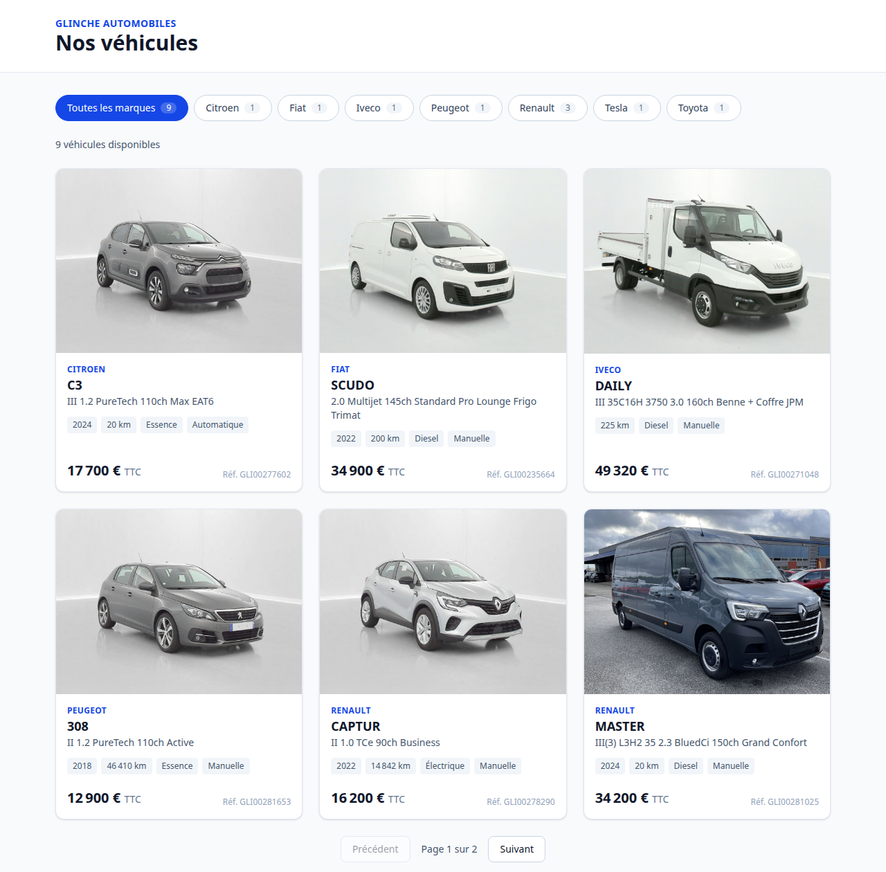

# Glinche – Catalogue de véhicules

Application qui récupère les véhicules de l'API partenaires Glinche (V1), les stocke en base et les affiche avec un filtre par marque et une pagination.

- **Back-end** : Laravel 13 (API uniquement), MySQL 9.7, tests Pest
- **Front-end** : Vue 3.5 + TypeScript (Composition API, `<script setup lang="ts">`), Vite, Tailwind CSS 4, tests Vitest
- **Environnement** : Docker Compose (`app`, `nginx`, `mysql`, `node`, `scheduler`)



## Sommaire

- [Installation avec Docker (recommandé)](#installation-avec-docker-recommandé)
- [Variables d'environnement](#variables-denvironnement)
- [Lancement sans Docker](#lancement-sans-docker)
- [Synchronisation des véhicules](#synchronisation-des-véhicules)
- [Tests](#tests)
- [API exposée](#api-exposée)
- [Architecture](#architecture)
- [Choix techniques](#choix-techniques)
- [Difficultés rencontrées](#difficultés-rencontrées)
- [Améliorations possibles](#améliorations-possibles)

## Installation avec Docker (recommandé)

Prérequis : Docker et Docker Compose.

```bash
git clone git@github.com:Razigue/glinche-vehicle-catalog.git
cd glinche-vehicle-catalog
cp backend/.env.example backend/.env
# Renseigner GLINCHE_API_URL, GLINCHE_API_EMAIL et GLINCHE_API_PASSWORD dans backend/.env
docker compose up -d --build
```

Au premier démarrage, le conteneur `app` installe les dépendances Composer, génère la clé applicative, exécute les migrations puis lance une première synchronisation. Le conteneur `node` installe les dépendances npm puis démarre Vite.

| Service | URL |
|---|---|
| Application Vue | http://localhost:5173 |
| API Laravel | http://localhost:8000/api |

Le premier démarrage prend environ une minute. `docker compose ps` indique `healthy` pour `app` une fois l'initialisation terminée.

> Sous Linux, les fichiers créés par les conteneurs appartiennent à l'utilisateur `1000:1000`. Avec un autre identifiant : `UID=$(id -u) GID=$(id -g) docker compose up -d --build`.

## Variables d'environnement

Toutes les variables sont dans `backend/.env` (copié depuis `backend/.env.example`, qui est déjà configuré pour Docker). Seules les variables propres à l'exercice sont à renseigner :

| Variable | Description | Valeur pour l'exercice |
|---|---|---|
| `GLINCHE_API_URL` | URL de base de l'API partenaires | `https://marketplace-dev.glinche-automobiles.com/api` |
| `GLINCHE_API_EMAIL` | Identifiant partenaire | fourni dans le sujet |
| `GLINCHE_API_PASSWORD` | Mot de passe partenaire | fourni dans le sujet, entre apostrophes car il contient `!` |
| `DB_*` | Connexion MySQL | déjà alignée sur le service `mysql` de `compose.yaml` |

Les identifiants ne sont jamais commités : `backend/.env` est ignoré par Git. Si une variable `GLINCHE_*` manque, l'application échoue dès l'appel au client avec un message explicite.

## Lancement sans Docker

Prérequis : PHP 8.3+ (extensions `pdo_mysql` ou `pdo_sqlite`), Composer, Node.js 20.19+ ou 22.12+.

### Laravel

```bash
cd backend
composer install
cp .env.example .env
php artisan key:generate
```

Dans `.env`, renseigner les variables `GLINCHE_*`, puis choisir la base :

- **MySQL local** : adapter `DB_HOST`, `DB_DATABASE`, `DB_USERNAME` et `DB_PASSWORD`.
- **SQLite** (plus simple) : remplacer le bloc `DB_*` par la seule ligne `DB_CONNECTION=sqlite`, puis exécuter `touch database/database.sqlite`.

```bash
php artisan migrate
php artisan vehicles:sync
php artisan serve            # http://localhost:8000
php artisan schedule:work    # optionnel, dans un autre terminal : synchronisation horaire
```

### Vue.js

```bash
cd frontend
npm install
npm run dev                  # http://localhost:5173
```

Vite relaie les appels `/api` vers `http://localhost:8000`. Pour une autre adresse, utiliser la variable `API_PROXY_TARGET` (Docker la règle sur `http://nginx`).

## Synchronisation des véhicules

```bash
docker compose exec app php artisan vehicles:sync   # ou php artisan vehicles:sync sans Docker
```

La commande affiche puis journalise (`storage/logs/laravel.log`) le bilan de la synchronisation :

```
+---------+---------+-----------+---------+---------+
| created | updated | unchanged | deleted | skipped |
+---------+---------+-----------+---------+---------+
| 0       | 0       | 9         | 0       | 0       |
+---------+---------+-----------+---------+---------+
```

Elle est aussi planifiée **toutes les heures** par le service `scheduler` (`php artisan schedule:work`), sans chevauchement possible, et lancée une fois au démarrage du conteneur `app`.

## Tests

```bash
docker compose exec app php artisan test   # back-end : 40 tests Pest
docker compose exec node npm test          # front-end : 18 tests Vitest
docker compose exec node npm run typecheck # front-end : vérification TypeScript
```

Sans Docker : `php artisan test` dans `backend/` et `npm test` dans `frontend/`.

Les tests back-end tournent sur SQLite en mémoire et simulent l'API Glinche avec `Http::fake()`. Ils couvrent :

- le client (token mis en cache, nouvelle connexion après un `401`, retry sur erreur serveur, erreurs réseau et réponses inattendues) ;
- le mapper (prix, photo, codes inconnus, champs obligatoires) ;
- la synchronisation (création, mise à jour, idempotence, suppression, regroupement des marques, annonce invalide, API indisponible, planification) ;
- les endpoints (forme de la réponse, filtre, pagination, tri, validation).

Les tests front-end couvrent le formatage, le filtre, la carte (image de secours), le composable `useVehicles` (requêtes concurrentes, erreurs) et la synchronisation avec l'URL.

## API exposée

### `GET /api/brands`

Marques ayant au moins un véhicule, triées par nom, avec leur nombre de véhicules.

```json
{ "data": [{ "name": "Renault", "slug": "renault", "vehicles_count": 3 }] }
```

### `GET /api/vehicles?brand={slug}&page={n}`

Véhicules triés par marque puis modèle, **6 par page**. `brand` et `page` sont optionnels. Réponse paginée standard Laravel (`data`, `links`, `meta`) :

```json
{
  "data": [{
    "id": 1,
    "reference": "GLI00004457",
    "brand": { "name": "Toyota", "slug": "toyota" },
    "model": "YARIS CROSS",
    "version": "Hybride 130h Design 2WD",
    "year": 2024,
    "mileage": 20,
    "energy": "Hybride essence",
    "gearbox": "Automatique",
    "price_in_cents": 2670000,
    "photo_url": "https://marketplace-dev.glinche-automobiles.com/storage/vehicles/pictures/69e0de4707fcc.jpg"
  }],
  "links": { "first": "…", "last": "…", "prev": null, "next": "…" },
  "meta": { "current_page": 1, "last_page": 2, "per_page": 6, "total": 9 }
}
```

## Architecture

```
backend/
├── app/Console/Commands/SyncVehicles.php     # commande vehicles:sync
├── app/Enums/{Energy,Gearbox}.php            # codes de l'API et libellés français
├── app/Http/Controllers/                     # BrandController, VehicleController
├── app/Http/Resources/                       # BrandResource, VehicleResource
├── app/Models/{Brand,Vehicle}.php
├── app/Services/Glinche/
│   ├── GlincheApiClient.php                  # authentification, cache du token, retry
│   ├── VehicleMapper.php                     # payload externe → VehicleData
│   ├── VehicleData.php                       # DTO immuable
│   ├── VehicleSynchronizer.php               # upsert, marques, suppressions
│   └── SyncReport.php                        # bilan de synchronisation
└── routes/{api,console}.php                  # endpoints et planification

frontend/src/
├── api.ts                                    # appels HTTP
├── types.ts                                  # types des réponses de l'API
├── composables/                              # useBrands, useVehicles, useUrlQuery
├── components/                               # BrandFilter, VehicleList, VehicleCard, PaginationNav
└── utils/format.ts                           # Intl.NumberFormat('fr-FR')

docker/                                       # Dockerfile PHP, script de démarrage, configuration nginx
```

Git flow : `main`, `develop` et une branche `feature/*` par fonctionnalité, fusionnée dans `develop` avec `--no-ff`. Commits conventionnels.

## Choix techniques

### Exploration de l'API avant de modéliser

La documentation est une page Swagger rendue en JavaScript. Elle charge la spécification OpenAPI depuis `/docs/openapi.json` : c'est ce fichier qui a servi de référence, avec un appel réel pour vérifier les données. Constats qui ont guidé le schéma :

- `POST /partners/login` renvoie un token Sanctum (`id|secret`), sans durée de validité indiquée.
- `GET /partners/vehicles` renvoie **tout le stock dans un tableau JSON, sans pagination** (les paramètres `page`, `per_page` et `limit` sont ignorés). Le client ne gère donc pas de pagination côté Glinche : il n'y en a pas.
- `reference` est l'identifiant stable d'une annonce et devient `external_id`.

### Client API

- **Token en cache pendant 50 minutes.** Sa durée de vie réelle étant inconnue, le client invalide le cache et se reconnecte une fois si l'API répond `401`. Le cache seul ne suffirait pas.
- **Timeout de 15 s et 3 tentatives**, uniquement sur les erreurs réseau et les erreurs serveur (5xx). Retenter un `401` ou un `422` ne servirait à rien.
- **Toutes les erreurs deviennent une `GlincheApiException`.** La commande n'a qu'un seul type d'erreur à traiter.

### Mapping et données

- **Validation de chaque annonce** (`Validator`) avant le mapping : une annonce incomplète est ignorée et journalisée, sans bloquer les autres.
- **Prix** : la spécification indique que `price` est le prix public TTC, mais ce champ est optionnel et absent des données actuelles. Le mapper l'utilise en priorité, puis se rabat sur `merchantPrice` (prix marchand TTC). Le prix est stocké **en centimes** (entier), et la conversion se fait sur la chaîne pour éviter les erreurs d'arrondi des flottants. Un prix nul devient « Prix sur demande » plutôt que « 0 € ».
- **Photo** : la photo `MAIN` (une seule autorisée par la spécification), sinon la première photo, sinon une image de secours côté front.
- **Énergie et boîte de vitesses** : les codes (`EH`, `AUT`…) sont stockés tels quels et convertis par des enums PHP dont les libellés français reprennent la spécification. Un code inconnu donne `null` au lieu de faire échouer la synchronisation.
- **`raw`** conserve l'annonce complète (équipements, autres photos…) pour de futurs usages sans nouvel appel à l'API.

### Synchronisation

- **La base est le miroir du flux** : un véhicule absent du flux ou portant une `deleteDate` est supprimé localement.
- **Idempotente** : identification par `external_id`. Une synchronisation sans changement ne modifie que `synced_at` et compte les véhicules comme `unchanged`.
- **Transactionnelle** : l'appel à l'API a lieu avant la transaction. Si l'API est indisponible, rien n'est modifié ni supprimé.
- **Annonce invalide mais toujours listée** : elle est ignorée et sa dernière version valide est conservée, plutôt que de supprimer un véhicule toujours en vente.
- **Marques identifiées par leur slug** : « Citroën », « Citroen » et « CITROEN » donnent une seule marque `citroen`.
- **Upsert ligne par ligne** (`firstOrNew`) plutôt qu'un `upsert()` groupé : cela permet un bilan précis (créé / modifié / inchangé). Pour quelques dizaines ou centaines de véhicules, le coût est négligeable.

### Pagination

La pagination est faite **côté serveur** (`paginate`) : le front ne reçoit que la page affichée, ce qui reste valable quand le stock grossit. Une pagination côté client aurait seulement masqué une liste déjà entièrement chargée.

- **6 véhicules par page** : deux rangées complètes de la grille à 3 colonnes, et un nombre divisible par les grilles mobile (1) et tablette (2). Avec les 9 véhicules actuels, la pagination est visible (2 pages).
- **Tri stable** (marque, modèle, puis `id`) : un véhicule ne peut pas apparaître sur deux pages.
- **Liste des marques indépendante de la page affichée** : elle vient de `/api/brands`, construite à partir des véhicules disponibles, avec un compteur par marque.

Le filtre est appliqué immédiatement au clic. La liste précédente reste affichée (estompée) pendant le chargement, sans écran blanc.

### Front-end

- **Marque et page dans l'URL** (`?brand=renault&page=2`) : un lien partagé ou une page rechargée affiche la même sélection, et les boutons précédent/suivant du navigateur fonctionnent. Une marque inconnue ou une page hors limites sont corrigées automatiquement.
- **Requêtes concurrentes** : un nouveau filtre annule la requête précédente (`AbortController`). Une réponse lente ne peut donc pas remplacer un résultat plus récent.
- **États gérés** : chargement (squelettes), erreur avec bouton « Réessayer », liste vide, image de secours.
- **Accessibilité** : `aria-pressed` sur le filtre, `aria-live` sur le nombre de résultats et la pagination, textes alternatifs sur les photos.
- Pas de Pinia ni de Vue Router : trois composables suffisent pour un seul écran.

### Docker

Images officielles uniquement (`php:8.4-fpm-alpine` complétée par `pdo_mysql`, `nginx`, `mysql:9.7`, `node:24-alpine`). Le service `app` n'est déclaré `healthy` qu'une fois les migrations passées : `nginx` et `scheduler` attendent cet état, ce qui évite les erreurs au premier démarrage. Vite relaie `/api` vers nginx, donc le front et l'API partagent la même origine et aucune configuration CORS n'est nécessaire.

## Difficultés rencontrées

- **Documentation rendue en JavaScript** : la page ne contient que du JavaScript. Il a fallu retrouver dans le bundle l'adresse de la spécification OpenAPI (`/docs/openapi.json`) pour lire les schémas, les enums et les descriptions de champs.
- **Durée de vie du token inconnue** : le token Sanctum n'indique pas d'expiration, contrairement à un JWT. D'où la combinaison cache + nouvelle connexion sur `401`.
- **Incohérences dans les données de test**, affichées telles qu'elles sont reçues :
  - le Renault Captur « TCe » (essence) est déclaré `EL` (électrique) ;
  - `catalogPrice` vaut `0.00` pour deux véhicules (d'où le choix de `merchantPrice`) ;
  - « Citroen » est écrit sans tréma (d'où le regroupement des marques par slug) ;
  - les libellés d'équipements ont un encodage cassé (non affichés) ;
  - l'Iveco Daily n'a pas d'année ;
  - les deux Renault Master sont identiques à la référence près (d'où l'affichage de la référence sur chaque carte).
- **Idempotence faussée par MySQL** : la colonne `JSON` de MySQL réordonne les clés à l'enregistrement. La comparaison stricte d'Eloquent voyait donc `raw` comme modifié à chaque synchronisation (« 9 updated » au lieu de « 9 unchanged »). SQLite conserve l'ordre, donc les tests ne détectaient pas le problème. Corrigé par une comparaison qui ignore l'ordre des clés, et couvert par un test dédié.

## Améliorations possibles

- **Fiche détaillée** par véhicule, avec la galerie complète et les équipements (déjà stockés dans `raw`).
- **Filtres et tris supplémentaires** : énergie, fourchette de prix, kilométrage, tri par prix.
- **Pagination numérotée** (1, 2, 3…) quand le nombre de pages augmentera. Pour l'instant, précédent/suivant suffit.
- **Nettoyage des marques** qui n'ont plus de véhicule (aujourd'hui seulement masquées par `/api/brands`).
- **Synchronisation en file d'attente** (job Laravel) et notification en cas d'échecs répétés.
- **Build de production** : image multi-étapes, `npm run build` servi par nginx, `APP_DEBUG=false`.
- **Intégration continue** (GitHub Actions) : Pint, Pest, Vitest et build front à chaque push.
- **Tests de bout en bout** (Playwright) sur le parcours filtre + pagination.
