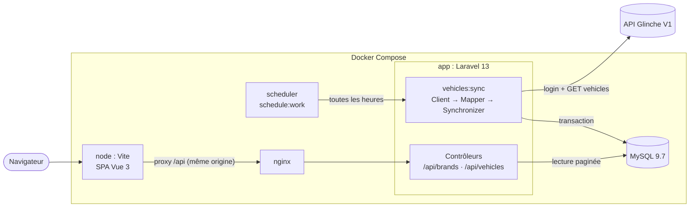
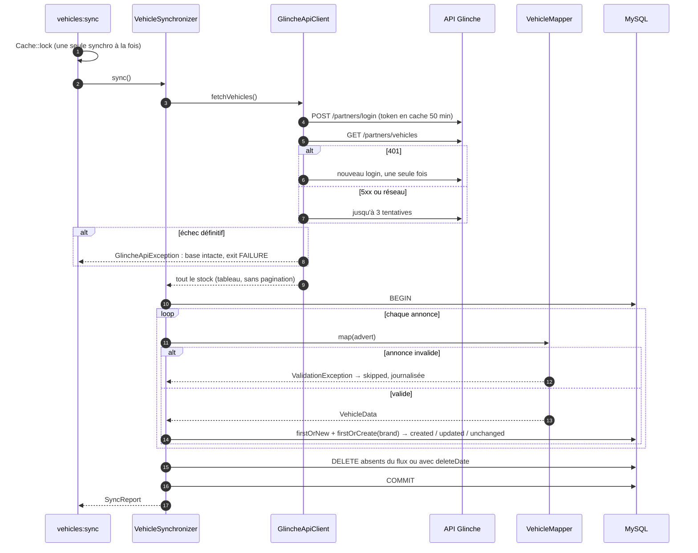
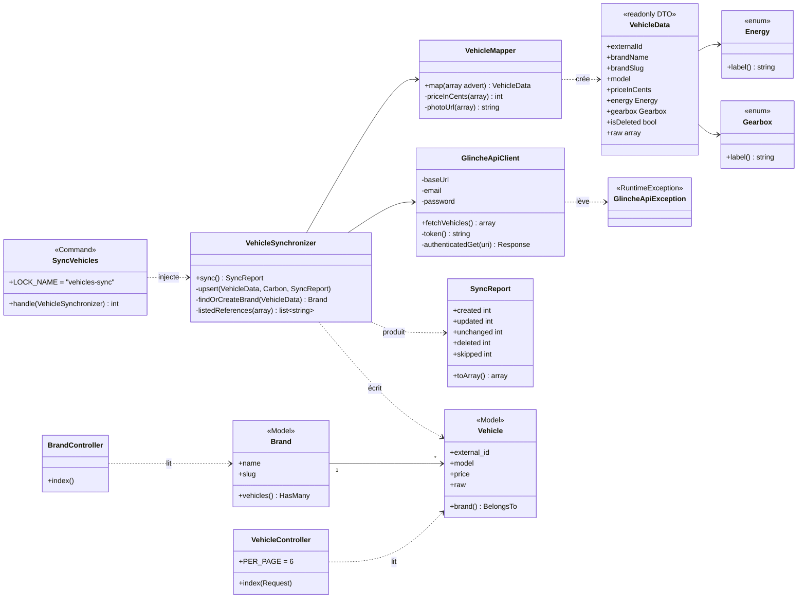
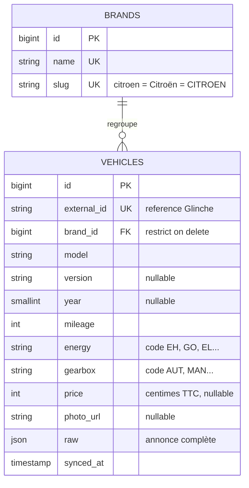
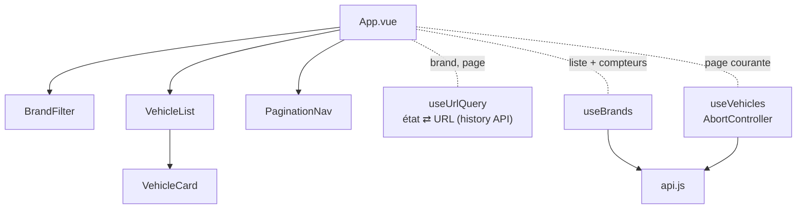

# Glinche – Catalogue de véhicules

Synchronisation du stock de l'API partenaires Glinche V1 dans une base locale, et catalogue Vue.js avec filtre par marque et pagination.

**Laravel 13** (API) · **MySQL 9.7** · **Vue 3.5** (Composition API) · **Tailwind CSS 4** · **Docker Compose** · **81 tests** (Pest + Vitest)


<table>
  <tr>
    <td width="30%"></td>
    <td valign="top">
      
      <p>Mobile, et état d'erreur quand l'API ne répond pas. La marque et la page sont dans l'URL (<code>?brand=renault&amp;page=2</code>) : un lien partagé ou une page rechargée garde la sélection, et le bouton retour du navigateur fonctionne.</p>
    </td>
  </tr>
</table>

## Sommaire

- [Démarrage](#démarrage)
- [Vue d'ensemble](#vue-densemble)
- [Synchronisation](#synchronisation)
- [Diagramme de classes](#diagramme-de-classes)
- [Modèle de données](#modèle-de-données)
- [Front-end](#front-end)
- [Décisions d'architecture](#décisions-darchitecture)
- [Qualité et tests](#qualité-et-tests)
- [API exposée](#api-exposée)
- [Ce que l'API m'a appris](#ce-que-lapi-ma-appris)
- [Pistes d'évolution](#pistes-dévolution)

## Démarrage

```bash
git clone git@github.com:Razigue/glinche-vehicle-catalog.git
cd glinche-vehicle-catalog
cp backend/.env.example backend/.env   # renseigner GLINCHE_API_URL, GLINCHE_API_EMAIL, GLINCHE_API_PASSWORD
docker compose up -d --build
```

Le conteneur `app` installe les dépendances, exécute les migrations et lance une première synchronisation. Il passe `healthy` après environ une minute.

| Service | URL |
|---|---|
| Catalogue (Vue) | http://localhost:5173 |
| API (Laravel) | http://localhost:8000/api |

```bash
docker compose exec app php artisan vehicles:sync   # synchronisation manuelle (planifiée toutes les heures)
docker compose exec app php artisan test            # 60 tests Pest
docker compose exec node npm test                   # 21 tests Vitest
```

<details>
<summary><b>Variables d'environnement</b></summary>

Tout est dans `backend/.env`, ignoré par Git. `backend/.env.example` est déjà configuré pour Docker, seules les variables `GLINCHE_*` sont à renseigner.

| Variable | Description |
|---|---|
| `GLINCHE_API_URL` | `https://marketplace-dev.glinche-automobiles.com/api` |
| `GLINCHE_API_EMAIL` | identifiant partenaire (fourni dans le sujet) |
| `GLINCHE_API_PASSWORD` | mot de passe partenaire, entre apostrophes car il contient `!` |

Si une variable `GLINCHE_*` manque, le client échoue avec un message explicite. Sous Linux avec un UID différent de 1000 : `UID=$(id -u) GID=$(id -g) docker compose up -d --build`.

</details>

<details>
<summary><b>Lancement sans Docker</b></summary>

Prérequis : PHP 8.3+ (`pdo_mysql` ou `pdo_sqlite`), Composer, Node.js 20.19+ ou 22.12+.

```bash
cd backend
composer install && cp .env.example .env && php artisan key:generate
# .env : renseigner GLINCHE_*, et pour SQLite remplacer le bloc DB_* par DB_CONNECTION=sqlite
touch database/database.sqlite   # si SQLite
php artisan migrate && php artisan vehicles:sync
php artisan serve                # http://localhost:8000
php artisan schedule:work        # optionnel : synchronisation horaire

cd ../frontend
npm install && npm run dev       # http://localhost:5173, /api relayé vers localhost:8000
```

`API_PROXY_TARGET` change la cible du proxy Vite (Docker la règle sur `http://nginx`).

</details>

## Vue d'ensemble

Deux flux indépendants : la **synchronisation** écrit en base (commande planifiée), le **catalogue** ne fait que lire. Le front ne dépend jamais de la disponibilité de l'API Glinche.



```
backend/app/
├── Console/Commands/SyncVehicles.php    commande vehicles:sync, verrou
├── Services/Glinche/                    client HTTP, mapper, DTO, synchroniseur, bilan
├── Enums/{Energy,Gearbox}.php           codes de l'API → libellés français
├── Models/{Brand,Vehicle}.php
└── Http/{Controllers,Resources}/        2 endpoints en lecture seule
frontend/src/
├── api.js                               fetch + ApiError
├── composables/                         useBrands, useVehicles, useUrlQuery
└── components/                          BrandFilter, VehicleList, VehicleCard, PaginationNav
```

## Synchronisation

La base est le **miroir** du flux Glinche. L'appel réseau a lieu **avant** la transaction : si l'API tombe, rien n'est modifié. Une annonce invalide est ignorée sans bloquer les autres.



```
+---------+---------+-----------+---------+---------+
| created | updated | unchanged | deleted | skipped |
+---------+---------+-----------+---------+---------+
| 0       | 0       | 9         | 0       | 0       |
+---------+---------+-----------+---------+---------+
```

Deuxième exécution sans changement côté Glinche : tout est `unchanged`, la synchronisation est idempotente.

## Diagramme de classes



Chaque classe a une seule raison de changer : le **client** connaît le protocole HTTP, le **mapper** connaît le format des annonces, le **synchroniseur** connaît les règles de mise à jour. Le DTO immuable `VehicleData` fait la frontière entre le monde externe et Eloquent.

## Modèle de données



Index `(brand_id, model)` aligné sur le tri de la liste.

## Front-end



- **L'URL est la source de vérité** : pas de store global. Les corrections automatiques (marque inconnue, page hors limites) remplacent l'entrée d'historique au lieu d'en ajouter une, pour ne pas piéger le bouton retour.
- **Requêtes concurrentes** : un changement de filtre annule la requête en cours, une réponse lente ne peut pas écraser un résultat plus récent.
- **Tous les états sont traités** : squelettes au premier chargement, liste précédente estompée pendant un changement de page, erreur avec « Réessayer », liste vide, image de secours.
- **Accessibilité** : `aria-pressed` sur le filtre, `aria-live` sur le compteur et la pagination, textes alternatifs.

## Décisions d'architecture

| Décision | Pourquoi | Alternative écartée |
|---|---|---|
| Synchro en commande planifiée, front en lecture seule | Le catalogue reste rapide et disponible même si Glinche ne répond pas | Appeler Glinche à chaque visite |
| Base miroir du flux (suppression des absents) | Un véhicule vendu disparaît du catalogue sans action manuelle | Suppression logique, conservation indéfinie |
| Appel API avant la transaction | Une panne ne vide jamais la base | Tout faire dans la transaction |
| Validation par annonce dans le mapper | Une donnée hors limites devient un `skipped` journalisé, pas une erreur SQL qui annulerait toute la synchro | Laisser la base rejeter |
| Token en cache + reconnexion unique sur `401` | La durée de vie du token Sanctum n'est pas documentée | Cache seul, ou login à chaque appel |
| Retry uniquement sur 5xx et erreurs réseau | Retenter un `401` ou un `422` ne changerait rien | Retry sur toute erreur |
| Prix en centimes, conversion sur la chaîne | Pas d'arrondi flottant, `0` affiché « Prix sur demande » | `float` ou `decimal` |
| Marques identifiées par slug | « Citroen » et « Citroën » sont une seule marque | Nom brut |
| `firstOrNew` ligne par ligne | Bilan exact créé / modifié / inchangé, coût négligeable à ce volume | `upsert()` groupé |
| Colonne `raw` (annonce complète) | Fiche détaillée possible plus tard sans nouvel appel | Ne stocker que l'affiché |
| Pagination serveur, 6 par page, tri marque → modèle → id | Payload constant quand le stock grossit, 6 remplit la grille en 1, 2 ou 3 colonnes, tri stable entre les pages | Pagination côté client |
| Vite relaie `/api` vers nginx | Même origine, aucune configuration CORS | CORS ouvert |
| Ni Pinia, ni Vue Router, ni repository pattern | Un seul écran, trois composables suffisent | Outillage prévu pour une application plus grande |

## Qualité et tests

- **60 tests Pest** (SQLite en mémoire, API simulée par `Http::fake()`) : client (cache du token, `401`, retry, réponses inattendues), mapper (prix, photo, codes inconnus, limites de colonnes), synchronisation (idempotence, suppressions, regroupement des marques, annonce invalide, API indisponible, verrou, planification), endpoints (filtre, pagination, tri, validation, limitation de débit).
- **21 tests Vitest** : formatage, filtre, carte, requêtes concurrentes de `useVehicles`, historique du navigateur dans `useUrlQuery`.
- **Pint** pour le style PHP, **commits conventionnels**, git flow `main` / `develop` / `feature/*` fusionnées en `--no-ff`.
- **Docker durci** : images officielles, ports publiés sur `127.0.0.1`, seul `index.php` exécutable par nginx, en-têtes de sécurité, 120 requêtes par minute et par IP. `nginx` et `scheduler` attendent que `app` soit `healthy`, c'est-à-dire migrations passées.

Les conventions du dépôt et les pièges connus sont décrits dans [`AGENTS.md`](AGENTS.md).

## API exposée

| Endpoint | Réponse |
|---|---|
| `GET /api/brands` | Marques ayant au moins un véhicule, avec `vehicles_count` |
| `GET /api/vehicles?brand={slug}&page={n}` | 6 véhicules par page, format paginé Laravel (`data`, `links`, `meta`) |

<details>
<summary>Exemple de véhicule</summary>

```json
{
  "id": 1,
  "reference": "GLI00004457",
  "brand": { "name": "Toyota", "slug": "toyota" },
  "model": "YARIS CROSS",
  "version": "Hybride 130h Design 2WD",
  "year": 2024,
  "mileage": 20,
  "energy": "Hybride essence",
  "gearbox": "Automatique",
  "price_in_cents": 2670000,
  "photo_url": "https://marketplace-dev.glinche-automobiles.com/storage/vehicles/pictures/69e0de4707fcc.jpg"
}
```

</details>

## Ce que l'API m'a appris

- **La documentation est rendue en JavaScript.** La spécification OpenAPI (`/docs/openapi.json`) a été retrouvée dans le bundle, puis confrontée à un appel réel. Elle a fixé les enums `energy` et `gearbox`, le rôle de `reference` et la priorité des prix.
- **`GET /partners/vehicles` n'est pas paginé** : tout le stock arrive dans un tableau, les paramètres `page` et `limit` sont ignorés. Le client n'a donc pas de boucle de pagination.
- **MySQL réordonne les clés JSON.** La colonne `raw` semblait modifiée à chaque synchro (« 9 updated » au lieu de « 9 unchanged »), ce que les tests SQLite ne voyaient pas. Corrigé par une comparaison indépendante de l'ordre des clés, et couvert par un test.
- **Les données de test sont incohérentes**, et affichées telles quelles plutôt que « corrigées » : Captur TCe déclaré électrique, `catalogPrice` à `0.00` (d'où `merchantPrice` en repli de `price`), « Citroen » sans tréma (d'où les slugs), Iveco Daily sans année, deux Renault Master identiques à la référence près (d'où la référence sur chaque carte).

## Pistes d'évolution

- Fiche détaillée avec galerie et équipements, déjà disponibles dans `raw`.
- Filtres énergie, prix, kilométrage, et tri par prix.
- Synchro en job de file d'attente, alerte après plusieurs échecs consécutifs.
- Build de production : image multi-étapes, front compilé servi par nginx, `APP_DEBUG=false`.
- CI GitHub Actions (Pint, Pest, Vitest, build) et tests de bout en bout Playwright.
